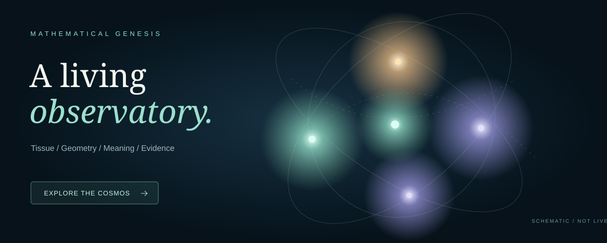

# ESMF-0 · Mathematical Genesis

*An experimental mathematical organism, and a question about how distinctions come into being.*

An organism is not handed a dictionary of the world. It encounters, acts, notices what persists and what changes, and sometimes needs to change **itself** to distinguish what it could not distinguish before.

ESMF-0 explores whether a resource-bounded learner can do something analogous: develop useful, revisable relations from experience, across different local representations, without mistaking a convenient encoding for meaning.

The aim is not a larger vector, a new name for a neural network, or geometry for its own sake. It is a place where **biology-inspired growth, geometry and semantic inquiry constrain one another**—and where we can tell when that idea fails.

[](https://dojo-1.github.io/ESMF-0-Mathematical-Genesis/)

*Explore the [Living Observatory](https://dojo-1.github.io/ESMF-0-Mathematical-Genesis/) — a source-linked, interactive 3D architectural schematic, not a live simulation.*

**[Run the live G0-AI Python Lab](https://dojo-1.github.io/ESMF-0-Mathematical-Genesis/live.html)** — a new interactive 3D instrument running the source-pinned synthetic Python substrate inside the browser via Pyodide. Enter an arithmetic expression or a short passage; a transparent task adapter turns it into four signed cues and an externally supplied label, while the actual Python tissue updates its activities, traces, contacts and resource ledger. **This is not mathematical reasoning, language understanding, or a new G0-AJ implementation.**

**[Enter the G0-AH Neurite Microscope](https://dojo-1.github.io/ESMF-0-Mathematical-Genesis/neurite.html)** to inspect executable 3D branch growth, local evidence, glial gating and delayed inhibition. Its events are deliberately selected source recordings, not evidence of neural cognition.

**[Watch G0-AI develop without assigned organs](https://dojo-1.github.io/ESMF-0-Mathematical-Genesis/genesis.html)** — a real synthetic 3D contact history, including its failed advantage against a fixed recurrent control.

## What lives here?

The project is a family of small, executable research models. Its ingredients are coupled questions, not a processing pipeline:

| | |
| --- | --- |
| **Encounters & questions** | What happened when the organism acted or interrogated its environment? Which question was being asked? |
| **Worldlets & transport** | Which relationships survive a change of context, coordinates or representation? What information is lost along the way? |
| **Memory & recognition** | What deserves to be retained, revised, doubted or forgotten without merging genuinely different experiences? |
| **Tissue & resources** | What can grow, connect, dissipate or be pruned when every observation and structural change has a cost? |

The code experiments with local geometric frames, neutral \((2,2)\) forms, nontrivial bundle transitions, partial observations, chemical guidance, paid morphology and evidence-gated adaptation. The G0-AD → G0-AG research modules are now integrated on **`main`**, including the joint neurite/glia-inspired simulator and continuous quaternionic transport. The newer experimental components remain hypotheses about learning, not demonstrated biological or cognitive advantages. **The 2D/3D tissue grids are numerical substrates, not a claim that thought lives in two or three Euclidean dimensions.**

## What have we actually learned?

Some mathematical transport and accounting contracts work. The strongest conventional controls also frequently **match or outperform** the more elaborate models. That is part of the research, not something to edit out.

Two recent *synthetic development* experiments are particularly instructive:

- [Ablating geometric and glial feedback](https://github.com/Dojo-1/ESMF-0-Mathematical-Genesis/pull/19) showed **no clear developmental advantage** in a short, conditioned tissue experiment; no quaternionic connection repairs occurred.
- [Preserving which question was asked](https://github.com/Dojo-1/ESMF-0-Mathematical-Genesis/pull/20) mattered more immediately: an ordinary question-conditioned memory scored **0.208** versus **0.243** Brier loss for the current context-pooled memory, on a small synthetic forecasting task.

Neither result establishes emergent semantics, biological cognition, quantum advantage or superior hypercomplex learning. The second does expose a precise problem worth fixing: a geometrically coherent learner can still discard the **interrogative context** of a distinction.

## Explore

From the repository root, with standard Python on CPU:

```bash
python -m unittest discover -s tests
python -m research.check_reproduction
python -m esmf.mechanochemical --steps 300 --seeds 0,1,2,3
```

For the organism's initial interaction model, see [the executable baseline](esmf/experiment.py). For the deeper geometric and biological questions, follow the map rather than reading a chronological log.

**[Explore the research by question](RESEARCH_MAP.md)** · **[Revisit the original research chronicle](RESEARCH_CHRONICLE.md)** · **[See the merged research history](https://github.com/Dojo-1/ESMF-0-Mathematical-Genesis/pulls?q=is%3Apr+is%3Amerged)**

## The boundary we keep

A passing test verifies the tested contract, not the intended philosophy. A geometric analogy is not a theorem about cognition. Synthetic resources are not measured physical energy. Evidence, hypotheses, assumptions and unresolved transport remainders remain separate.

ESMF-0 is unfinished by design. Its purpose is not to make the organism agree with a preconceived geometry, but to discover **which distinctions and structures its own encounters can justify**.

